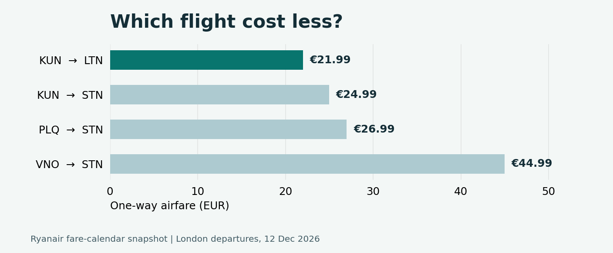
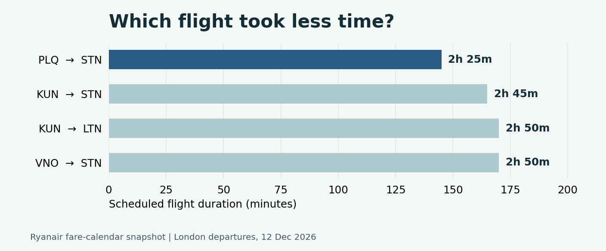

# Lithuania Flight Planner

A Windows desktop app for comparing one-way flights from Vilnius (VNO), Kaunas (KUN) and Palanga (PLQ) to European destinations. Search for one traveler or build a group itinerary with separate routes, arrival times and fares for each person.

## Example search: Lithuania to London

Ryanair's fare calendar returned four direct offers for **12 December 2026** in a snapshot taken on **19 November 2026**. These are airfare-only observations from one source.

| Decision | Flight | Fare | Duration |
|---|---|---:|---:|
| Lowest fare | Kaunas → Luton | €21.99 | 2 h 50 min |
| Shortest flight | Palanga → Stansted | €26.99 | 2 h 25 min |

In this search, paying **€5 more** saved **25 minutes in the air**. The flights also land at different airports, so ground travel can change the preferred route.

[View the data behind the charts](docs/media/london-snapshot.json). Prices and availability change.

## How it works

1. **Collect offers.** Python requests live results through the unofficial Google Flights adapter [fli](https://github.com/punitarani/fli). The Ryanair fare calendar provides a direct-flight fallback.
2. **Compare routes.** Python normalizes fares and durations. [SQL](ranking.sql) ranks the offers in an in-memory SQLite database by cost, duration or a balanced score that weights both equally. The search tries the selected date across departure airports before checking nearby dates.
3. **Plan a group.** Choose a route and date for each traveler, save the selected flight and review the table of local arrival times and fares. You can replace individual flights and see the group total by currency.

Optional ground travel estimates can be entered manually. The charts contain flight time and airfare only. Baggage, booking fees and onward travel are outside those figures.

## Run on Windows

1. Install Python 3.11 with Tkinter and run `setup.bat` once.
2. Double-click `launch.pyw`.
3. Create a local account, then choose **Solo** or **Group**.

Local accounts are stored in SQLite with salted password hashes. Search results are held in memory and the group cart lasts for the current Group session.
